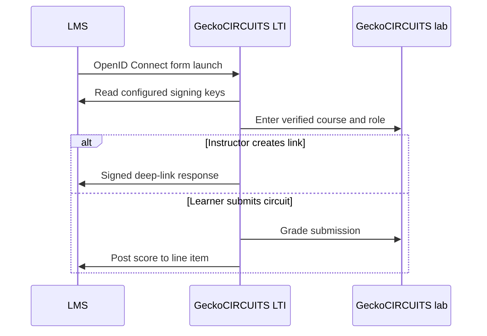

# Use registered LTI platforms and course-scoped identities

ADR-0025 · Codex for tinix84 · 2026-11-25 · Version 1.0  
Audience: GeckoCIRCUITS REST API maintainers.

**Decision**  
Use explicit Learning Tools Interoperability (LTI) 1.3 registrations and map each validated course context to one lab tenant.

## Context

LTI launches supply platform, deployment, course, role, and user claims. The client application must verify the signed claims before it uses them. Issue [#33](https://github.com/tinix84/GeckoCIRCUITS/issues/33) needs course-level assignment access, deep links, and grade passback. Figure 1 shows where the three LTI messages cross the application boundary.

*Figure 1. The lab receives the course identity after launch validation.*

## Options

| Option | Pros | Cons | Cost |
| --- | --- | --- | --- |
| Explicit registration and course-scoped session | Operators set trusted origins and deployments. Course identities stay stable. | An operator configures each registration. | Medium |
| Dynamic registration and shared API access token | Reduces registration steps for supported platforms. | Adds discovery and exposes general API authority to the launch. | High |

## Decision and rationale

Configure issuer, client ID, deployment ID, authorization URL, JSON Web Key Set URL, token URL, and allowed return origins. Use Nimbus to validate the signature and check expiry, audience, state, and nonce. Consume the state once and bind it to the browser that started the login.

Derive the tenant from issuer, client ID, deployment ID, and context ID. Derive the lab subject from the tenant and the platform subject. Map context Instructor to ADMIN and Learner to USER. Keep the browser session scoped to the lab and the signed launch. Publish the public key that verifies the tool's messages.

## Consequences

- The tool can sign assignment deep links and send grades to line items from verified launches.
- The operator controls the trusted origins for deep links and grade service calls.
- The initial deployment stores short-lived login and session state in one server process. Use session affinity or shared state before adding replicas.
- Tenant integration with the rest of the API follows [#25](https://github.com/tinix84/GeckoCIRCUITS/issues/25).

[1EdTech LTI Core](https://www.imsglobal.org/spec/lti/v1p3) · [Deep Linking](https://www.imsglobal.org/spec/lti-dl/v2p0) · [Assignment and Grade Services](https://www.imsglobal.org/spec/lti-ags/v2p0)

## Status

Proposed by Codex on 2026-11-25.
